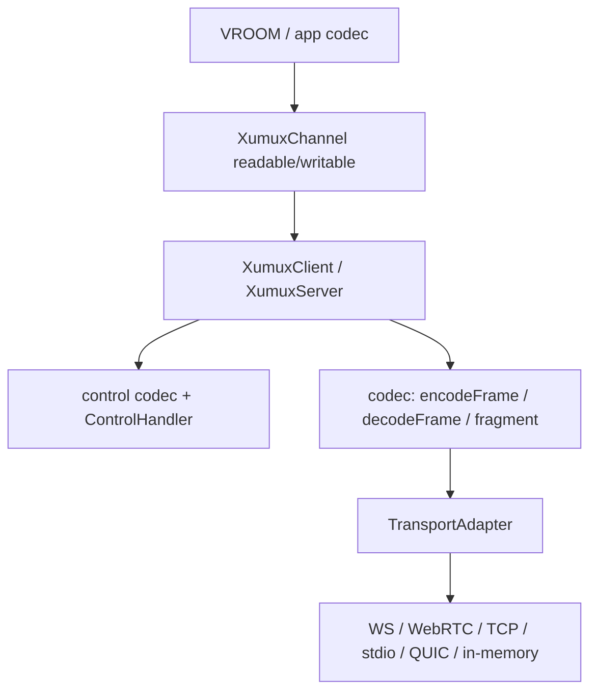

# Architecture / I/O pipeline

libxumux is the TypeScript implementation of [xumux](https://github.com/deftai/xumux). It multiplexes named channels over one byte-oriented underlay.

Internally this matches Deft’s Subspace stack — **ByteTransport → Framer → Codec → Connection\<T\>** — with two important seams:

1. The **mux-level codec is frame ↔ bytes**. That is the xumux wire format (8-byte header, magic `OMUX`, fragmentation).
2. **Application / [VROOM](https://github.com/deftai/vroom) codecs live above `XumuxChannel`**. They read and write `Uint8Array` payloads on a channel’s Web Streams pair. Those codecs are out of scope for this package.

Subspace **middleware** and **presets** have no analogue here. Compose them above the channel streams, or wrap a `TransportAdapter`.

## Layer map

| Subspace concept | libxumux type / folder | Role |
| --- | --- | --- |
| ByteTransport | `TransportAdapter` (`src/types.ts`); `src/transports/*` | Uniform `send` / `receive` / `close` over an underlay |
| MessageTransport (in-process / test) | `InMemoryAdapter` + `createInMemoryPair()` (`src/transports/in-memory-adapter.ts`) | Two adapters that enqueue frames to each other with no network I/O |
| Framer | `src/codec/*` | Frame encode/decode, stream `FrameDecoder`, `OMUX` magic, fragment / reassembly |
| Codec (mux) | same `src/codec/*` (`encodeFrame` / `decodeFrame`) | Binary frame ↔ bytes. Not an application message codec |
| Codec (control) | `src/control/codec.ts` + `src/control/messages.ts` | HELLO / WELCOME / OPEN_CHANNEL / PING / CLOSE / … ↔ `Frame` |
| Connection\<T\> | `XumuxPeer` / `XumuxClient` / `XumuxServer` (`src/connection.ts`) | Session: handshake, receive loop, channel map |
| Per-channel stream | `XumuxChannel` (`src/channel.ts`) | `{ readable, writable }` of `Uint8Array` |
| Application Codec\<T\> / VROOM | *above this package* | Typed RPC / messages on a channel’s byte streams |

Control-channel *lifecycle* (handshake, keepalive, open/close channel) lives in `src/control/handler.ts` (`ControlHandler`). `XumuxPeer` wires it to the transport and the channel map.

## Pipeline



Inbound path in `XumuxPeer`:

1. `transport.receive()` yields **complete frame bytes** (stream adapters strip `OMUX` and run `FrameDecoder` first).
2. `decodeFrame()` produces a `Frame`.
3. Channel `0x0000` → `ControlHandler`. Other channels → `Reassembler` → `XumuxChannel.readable`.

Outbound: `XumuxChannel.writable` → `fragment()` → `encodeFrame()` → `transport.send()`.

## Transports: attach, not dial

Adapters wrap an **already-open** underlay. The caller dials, accepts, or otherwise obtains the socket / WebSocket / DataChannel / stream pair, then passes it in:

| Adapter | Constructor | Notes |
| --- | --- | --- |
| `WebSocketAdapter` | `WebSocketLike` | Message-oriented. No `OMUX`. Identify via the `x-xumux` subprotocol. |
| `WebRTCAdapter` | `DataChannelLike` | Message-oriented. No `OMUX`. Set DataChannel `protocol` to `x-xumux`. |
| `TcpAdapter` | connected `net.Socket` | Stream-oriented. Sends/validates `OMUX`, then `FrameDecoder`. |
| `StdioAdapter` | optional `Readable` / `Writable` (default `stdin`/`stdout`) | Same stream framing as TCP. For process IPC. |
| `QuicAdapter` | `{ readable, writable }` stream pair | Message-oriented. No `OMUX`. WebTransport datagrams or a bidi stream. |
| `InMemoryAdapter` | via `createInMemoryPair()` | In-process pair. Tests and local loopback. |

There is no `dial(url)` inside the adapters. Connection setup stays with the application (or a higher helper).

`TransportAdapter.receive()` is specified to yield **complete frames**, not raw chunks. Stream adapters therefore embed a slice of the Framer (`OMUX` + `FrameDecoder`). Message adapters treat each underlay message as one frame.

## The VROOM seam

`XumuxChannel` is the public application boundary:

```ts
channel.readable  // ReadableStream<Uint8Array>  — reassembled payloads
channel.writable  // WritableStream<Uint8Array>  — fragmented on write if needed
```

[VROOM](https://github.com/deftai/vroom) (and any other app protocol) should:

- treat each channel as an independent byte duplex;
- encode/decode its own messages on those streams;
- not depend on `src/codec` frame types.

libxumux does not interpret application `Frame.type` values on channels `1–65534`.

## In-memory underlay

`createInMemoryPair()` is the MessageTransport / test-double analogue: two `TransportAdapter`s that deliver `send()` on one end to `receive()` on the other, with no sockets.

It is used by unit tests and by the `XumuxClient` / `XumuxServer` examples. It is **not** a published package export (`package.json` only ships websocket, webrtc, tcp, stdio, quic). Import from source or copy the helper in tests.

```ts
import { XumuxClient, XumuxServer } from 'libxumux';
import { createInMemoryPair } from './transports/in-memory-adapter.js';

const [clientTransport, serverTransport] = createInMemoryPair();
const client = new XumuxClient(clientTransport);
const server = new XumuxServer(serverTransport);
```

## Folder cheat sheet

```
src/
  types.ts              TransportAdapter, OMUX_MAGIC
  connection.ts         XumuxPeer, XumuxClient, XumuxServer
  channel.ts            XumuxChannel streams
  codec/                Framer + mux-level frame codec
  control/              control-channel codec + ControlHandler
  transports/           ByteTransport adapters (incl. in-memory)
```

Public barrel: `src/index.ts`. Transport adapters are separate entry points (`libxumux/transports/websocket`, …).
